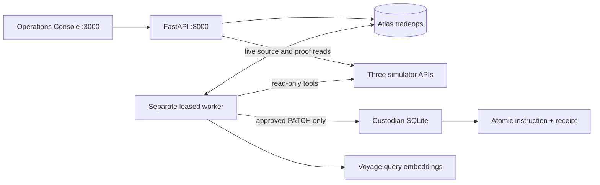

# ProofStep / TradeOps architecture

Implemented for MongoDB Agents in Context Toronto, Track 3 **Finish the Job**, following the team's final
ProofStep TradeOps Build Handoff. ProofStep is the durable control layer; TradeOps is the use case; the
Operations Console is the frontend. This document describes actual behavior, including compatibility
choices that preserve the frontend/simulator contracts merged into main.

## 1. Scope and data

One fictional rejected settlement instruction, one allowed business mutation: amend its safekeeping
(receiving) account. Final status is ACCEPTED for processing, not settled. No real assets move.

| Authority | Record |
|---|---|
| Public SEC context in Atlas | `F92124100:2026-09-15`, TTE, 1,277 aggregate outstanding failed shares, Decimal128 prior close 91.14 |
| Broker SQLite | `TR-2041`, `P-17`, BUY 100 TTE, CUSIP F92124100, USD 91.20, executed 2026-09-14, settlement 2026-09-15 |
| Custodian SQLite | `SI-2041`, revision 1, REJECTED, INVALID_SAFEKEEPING_ACCOUNT, SAFE-100 |
| Directory SQLite | SAFE-100 retired; SAFE-401 active/authorized for P-17; mappingRevision 7 |
| Approved outcome | Revision2, SAFE-401, ACCEPTED; one operation receipt |

The supplied JSONL contains 66,693 observations, 13,397 CUSIPs and 12 dates in September 15–30, 2026. Import
uses Extended JSON parsing, BSON UTC dates, Decimal128 prices, validation and batched `_id` upserts.
383 null prices and one blank symbol are valid missing values, not invented prices/tickers. The market
collection has a compound cusip/settlement_date index. The worker joins only after broker/custodian trade
facts agree, using both CUSIP and settlement date. Market context supplies neither account mapping nor
root cause and is never changed by a simulated correction.

## 2. Processes and trust boundaries



`scripts/dev.sh` starts API :8000, broker :8101, directory :8102, custodian :8103 and Vite :3000. Each simulator has
its own persistent SQLite file under gitignored `backend/simulators/data/`. `scripts/worker.sh` starts a
separate killable process. API/browser refreshes do not execute custodian mutations. All HTTP services
bind to localhost. Runtime uses PyMongo, not MCP.

One worker holds `workers._id=workflow-worker` with a five-second lease and one-second heartbeat. It
checks ownership before intent and dispatch. A second worker refuses to take an active lease. SIGTERM
releases it; hard exit leaves it to expire. Process IDs and worker instance IDs are distinct per start.

## 3. Atlas documents and compatibility

| Collection | Purpose |
|---|---|
| `cases` | One active synthetic case per caseId: stage/version/runId, evidence, persisted tool phase, proposal/hash, approval, operation/checkpoint, verification, latest 100 events |
| `case_runs` | Archive previous active document on reset, unique (caseId,runId) |
| `incidents` | Ten synthetic learning cases; nine VERIFIED have real Voyage vectors; one unverified excluded |
| `policies` | Allowed mutation/portfolio, policy version, required role and authorized reviewer identities |
| `workers` | Scoped lease, heartbeat, current instance/PID and stoppedAt |
| `market_fail_observations` | All supplied public observations; BSON dates/decimals preserved |
| `healthcheck` | Harmless connectivity verification collection |

The existing schema is retained: handoff `instructionId/demoRunId/intent/timeline` correspond to
`caseId/runId/operation/events`; API returns those aliases too. `workers` serves the proposed
worker_heartbeats role. Existing `incident_vector_index` and incident INC-004 implement the handoff's
example incident_memory/INC-DIR-002. Mutation enum stays `AMEND_SAFEKEEPING_ACCOUNT`. These are naming
compatibility choices, not missing behaviors. Current-case uniqueness plus archived `(caseId,runId)`
preserves history without breaking existing UI/routes.

CaseStore updates match caseId + synthetic + runId + expected stage + version, increment version and
append one event atomically. Stale updates lose the comparison. Case reads use majority; writes use
majority+journaled acknowledgement. Strict cases validation and unique operation IDs prevent malformed
or duplicate active intents. Dates are BSON dates internally; API serialization turns decimals into
strings to preserve exact price display.

## 4. State machine and investigation

```text
NEW → INVESTIGATING → AWAITING_APPROVAL → APPROVED → AWAITING_VERIFICATION → VERIFIED
          ├→ NO_ACTION       └→ DENIED       └→ INVESTIGATING (approval inputs changed)
          └──────────────────────────────→ MANUAL_REVIEW (conflict/unsupported/unsafe)
```

Investigation persists its phase after each read, so an interruption resumes from a saved phase rather
than replaying the event history. Order: custodian instruction → broker trade → compare identity facts
→ attach SEC context → check retired account → optional demo pause → directory account → validate active
account → proposal. An already-accepted instruction terminates NO_ACTION with zero writes.

Identity includes tradeId, portfolio, CUSIP, symbol/security, quantity, side and settlement date. A
mismatch cannot be explained away using aggregate market data. The account must be ACTIVE, authorized
and owned by the same portfolio.

The deterministic investigator first expects v1 `settlementAccount`. A changed shape triggers a real
Voyage query and Atlas `$vectorSearch`, filtered to VERIFIED synthetic directory incidents and the
configured model. The stored retrieval includes actual query, incident IDs/scores and next-check
suggestions. INC-004 suggests GET_DIRECTORY_CONTRACT, which is recorded as the tool step's guidedBy.
The live `/contract` must map v1 to settlementAccount or v2 to delivery.safekeepingAccount; only these
validated adapters are permitted. It then re-reads account data and validates account status independently.
v3/unknown paths, contradictory fields or conflicting evidence go to MANUAL_REVIEW. A missing retrieval
service is shown honestly as PENDING; safe contract inspection may still proceed, but the semantic
retrieval portion of the demo is then incomplete. Only vector aggregation uses local read concern
because Atlas rejects majority there; it does not weaken case durability.

## 5. Approval and durable dispatch

Reviewer signs in with the local server-configured demo token. Server session cookie is HttpOnly and
SameSite strict; identity/role are derived from server config and current policy. CLI tests may use
X-Reviewer-Token. Every mutating control requires reviewer auth; an arbitrary actor field is ignored.
Sessions are local memory and disappear on API restart. This is a demo boundary, not production SSO.

Proposal binds case/run/instruction/trade/portfolio, expected custodian revision, old/new account,
mapping revision, allowed mutation and policy version. Canonical SHA-256 binds exact approval.
Version/hash/policy mismatches fail; DENY is terminal. APPROVE does not execute: Apply separately sets
executionRequested. Immediately before intent the worker rechecks current approval/policy, instruction
revision/account/status and trade facts, directory contract/mappingRevision and account authorization.
A changed input invalidates the approval and restarts investigation for a new proposal.

`persist_intent` atomically records AWAITING_VERIFICATION, original operationId/idempotency key, approved
payload, canonical wire request, payloadHash, retry budget and checkpoint worker ID. It must return a
majority+j acknowledged document before any PATCH. Failure prevents dispatch. A deliberate pre-send
crash occurs immediately after this checkpoint, while PATCH count remains zero.

The worker sends expectedRevision/accountId and Idempotency-Key. Custodian stores the canonical hash
of `{instructionId,expectedRevision,accountId}`. The proposal hash binds approval's full scope; payloadHash
binds the smaller external operation. They have separate purposes and must both remain consistent.

## 6. Custodian and recovery contract

Custodian checks a known idempotency key before checking current revision. Same key and canonical
payload returns the original receipt; same key with another payload returns 409. For a new operation,
expectedRevision must match, and instruction update plus receipt commit in one SQLite transaction.
Lost-reply injection happens after commit: response is delayed beyond the client timeout. Worker may
hard-exit 137 before saving any outcome, leaving the majority intent as the recovery source.

On restart a new worker records RESUMED_FROM_CHECKPOINT once and loads the original operation. It reads
`/operations/{operationId}` AND `/instructions/{instructionId}`. VERIFIED requires matching operation ID,
instruction, account, revision=expected+1, ACCEPTED status, receipt ID, payloadHash, latestOperationId
and unchanged stable trade facts. An acknowledgement alone never establishes completion.

| Read-back result | Action |
|---|---|
| Receipt and instruction match saved intent | VERIFIED; no resend |
| Confirmed operation 404 with matching unchanged baseline | Recheck current approval/policy/mapping, then retry original key/payload only within persisted budget (max 3 dispatch attempts) |
| Operation lookup 503/timeout/unavailable | Bounded deferral (5) then MANUAL_REVIEW; never treat as absence |
| Receipt/instruction conflict or changed baseline | MANUAL_REVIEW; no resend |

The headline demo has one PATCH and one receipt after crash/restart. More than one PATCH can occur in
other confirmed-absence/retry scenarios; the receiving system's stable-key contract still protects the
business effect. The proof panel displays actual counters and calls an effect "applied exactly once"
only when the case is VERIFIED and the matching operation receipt is present.

## 7. Reset and validation

Reset acquires the same worker lease and refuses 409 while a worker is active. It resets only synthetic
simulators, archives the old Atlas case, creates a new runId, clears approvals/intent and defaults pause
ON/faults OFF. It preserves public market observations, verified incident memory and policy. Separate
systems are not reset in a distributed transaction: run reset with all local services healthy; rerun if
interrupted. Never reset during an execution or describe it as production transaction recovery.

66 passing tests include 9 tests running real worker/simulator/API processes against organizer Atlas,
with actual exit 137 both after external commit and before send. Isolated test IDs/ports/SQLite files
preserve canonical data. Browser rehearsal verified the same main path through real controls.
See demo-script.md and mongodb-setup.md for operation and evidence.
